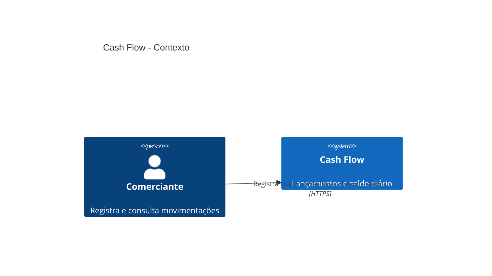
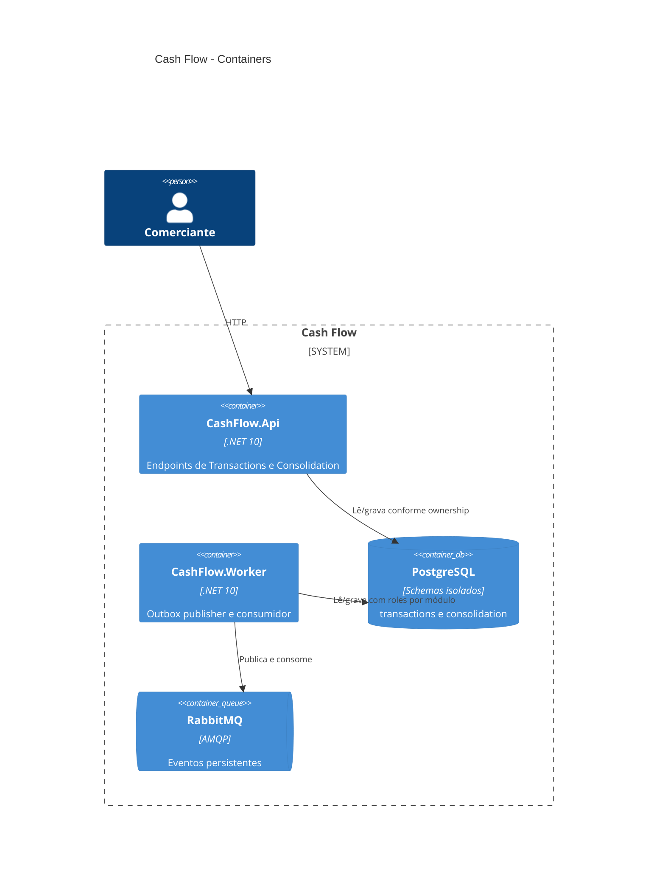
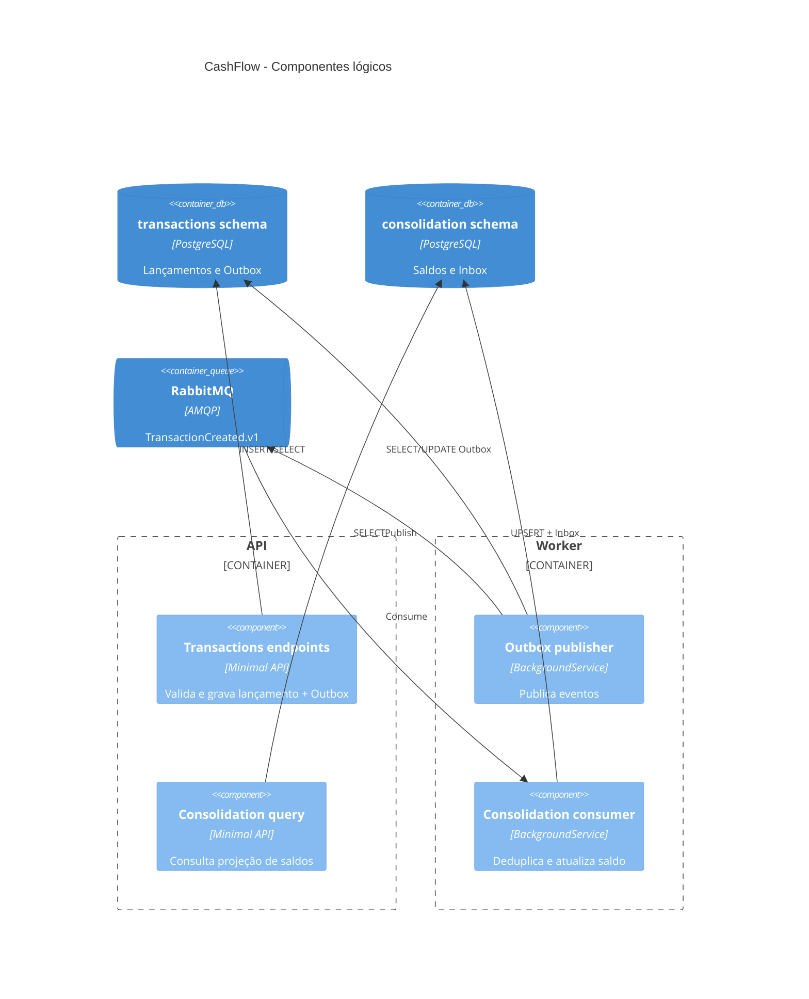
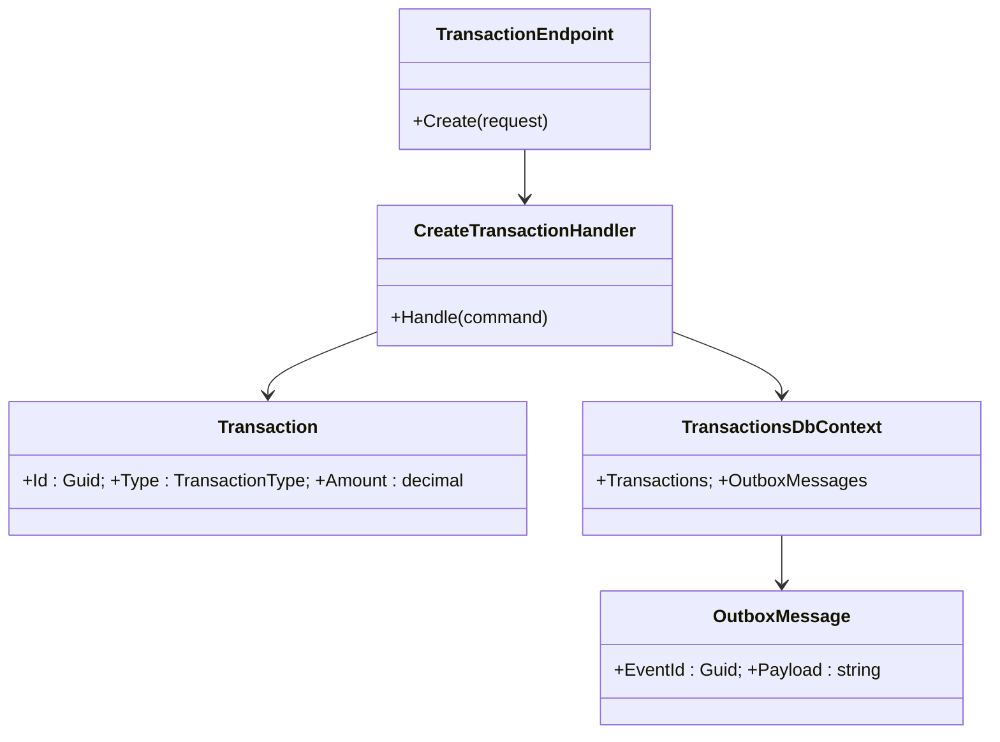
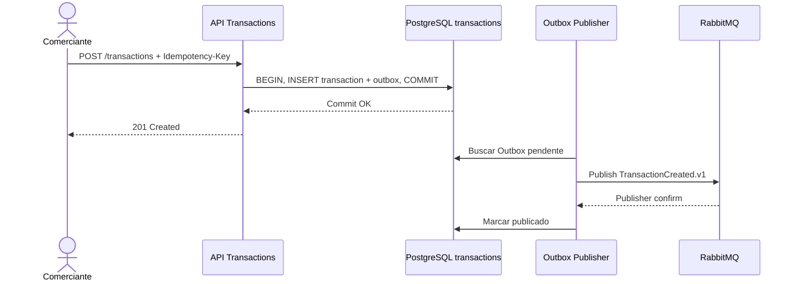
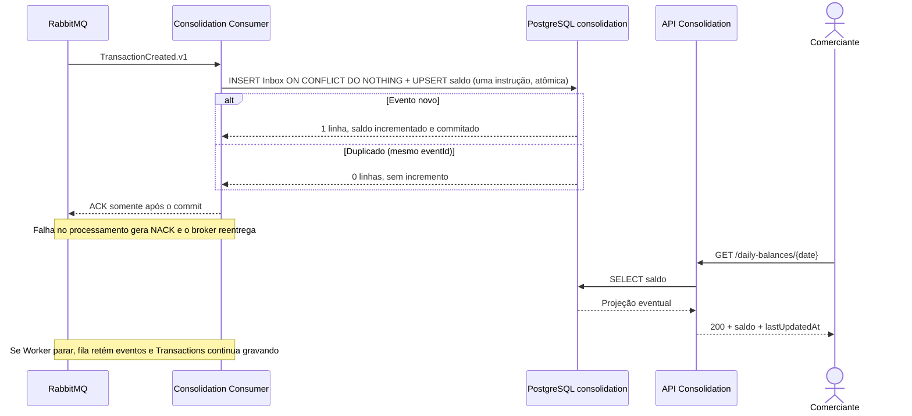

# Diagramas — C4 e sequências (Mermaid)

> Mermaid não suporta todos os recursos do C4 igualmente em todos os renderizadores. Diagramas C4Context/C4Container/C4Component abaixo usam a sintaxe C4 do Mermaid; nível 4 usa classDiagram como representação de código. Verificar renderização no GitHub e ajustar se necessário.

## C4 — Nível 1: Contexto

## C4 — Nível 2: Containers

## C4 — Nível 3: Componentes

## C4 — Nível 4: Código (recorte Transactions)

## Sequência — registro

## Sequência — consolidação e falha

