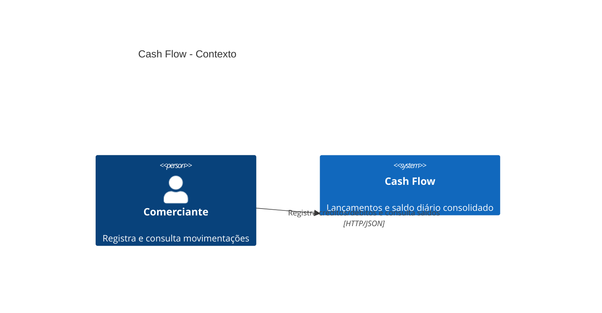
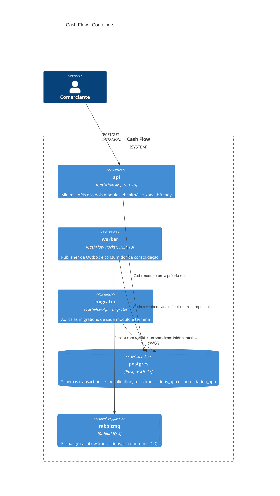
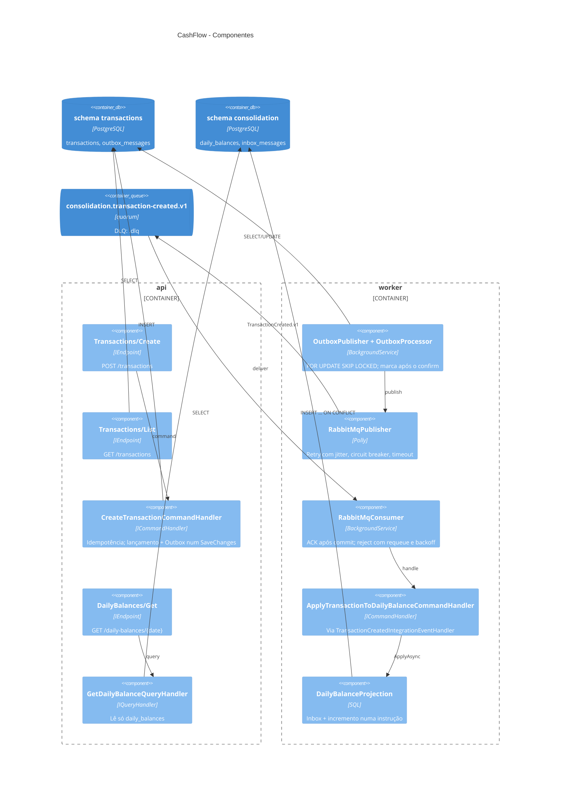
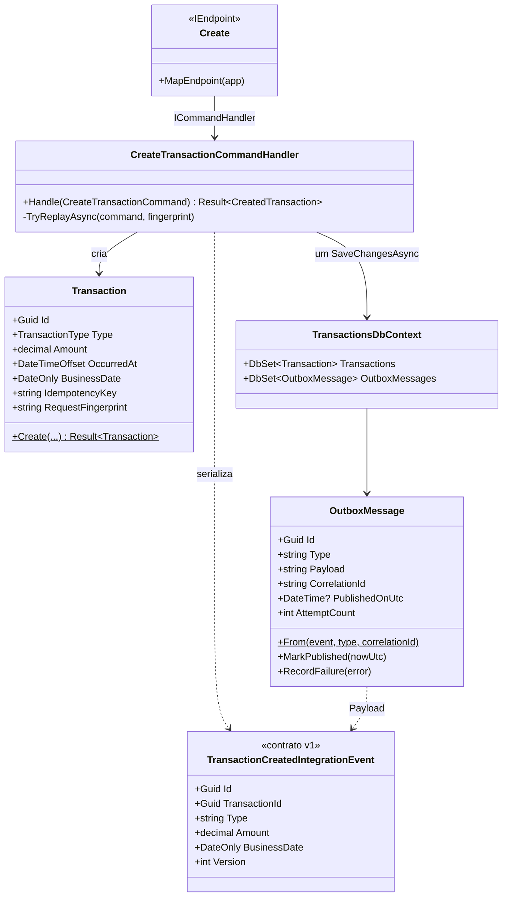
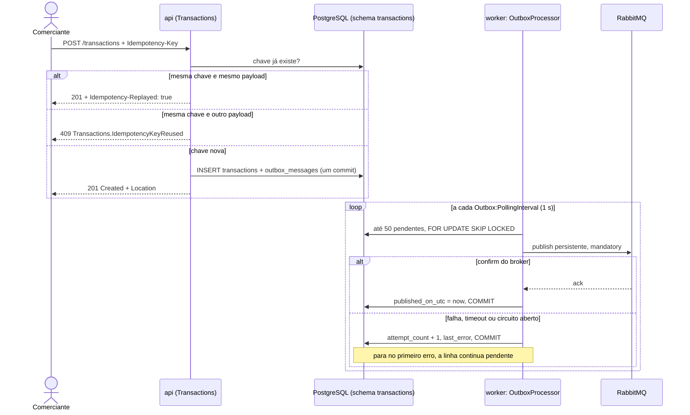
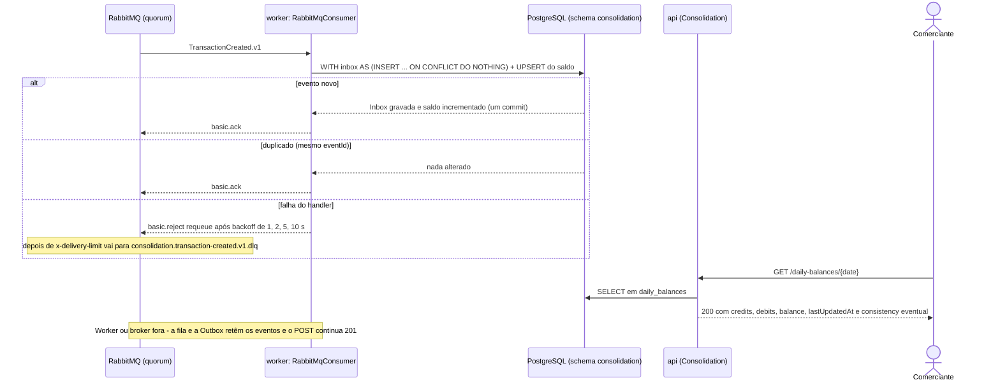

# Diagramas — C4 e sequências (Mermaid)

> Desenhados a partir do código (nomes de projetos, classes, filas e serviços do Compose conferidos em 2026-10-26). Os níveis 1–3 usam a sintaxe C4 do Mermaid; o nível 4 usa `classDiagram`. Sintaxe validada por renderização Mermaid. Contratos: [OpenAPI](../api/openapi.json) e [exemplo do evento](../api/events/transactions.transaction-created.v1.json).

## C4 — Nível 1: Contexto

## C4 — Nível 2: Containers
Serviços do [docker-compose.yml](../../docker-compose.yml). A API não tem dependência do RabbitMQ: é isso que mantém o `POST /transactions` no ar com o broker ou o Worker fora.

## C4 — Nível 3: Componentes
Cada caixa é uma classe real; os módulos só se falam pelo contrato `TransactionCreated.v1` (projeto `Transactions.IntegrationEvents`).

## C4 — Nível 4: Código (recorte do registro)

## Sequência — registro e publicação

## Sequência — consolidação, falha e leitura

